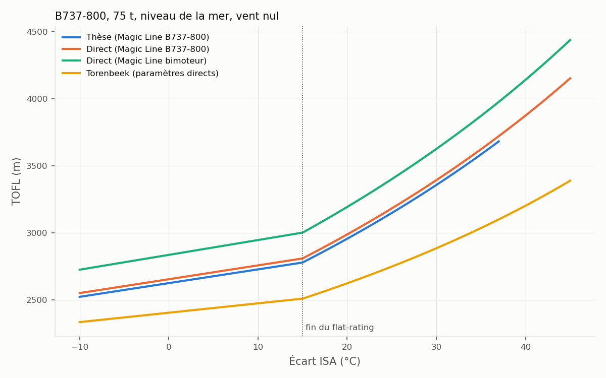
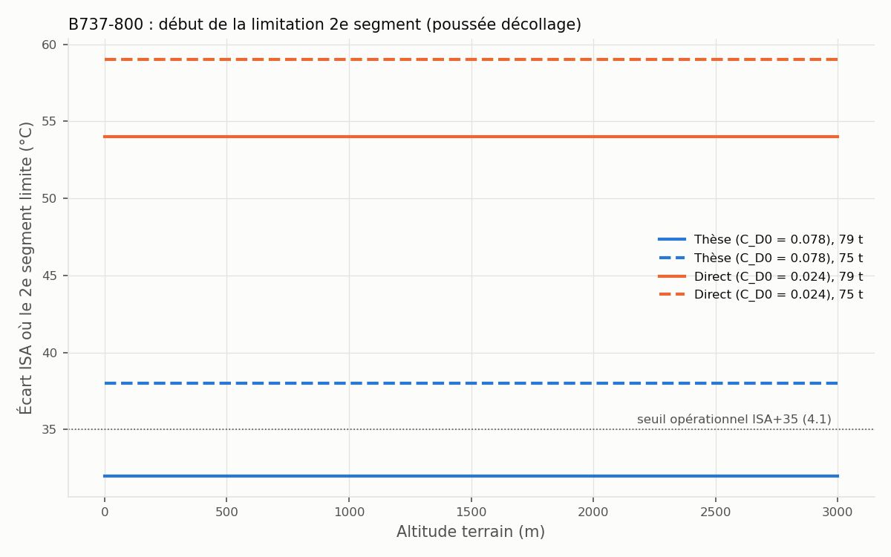

# Étude indépendante du B737-800 : comparaison avec la modélisation de la thèse

Objectif : reconstruire les paramètres du B737-800 à partir de sources publiques, sans
partir des valeurs de la thèse (S. Salles, 2025, § 5.5.1), puis mesurer l'effet des
différences sur les résultats du modèle Magic Line.

Résultats reproductibles avec `python etude_b738.py`. Figures dans `figures/`.

## En bref

1. **Géométrie, masses, poussée, C_L,max : la thèse est confirmée** par les sources
   publiques, à 1 % près.
2. **La polaire de la thèse est beaucoup plus traînante** que ce que donnent les sources
   publiques : C_D0 = 0.078 contre 0.024, soit une finesse au décollage de 9.3 contre 12.2.
3. **Hors limitation 2e segment, la polaire n'a aucun effet sur la TOFL.** Elle ne
   décide que du moment où le 2e segment devient limitant, et là l'écart est grand :
   à 79 t, ISA+32 °C avec la thèse contre ISA+54 °C avec la polaire indépendante.
4. **Une méthode indépendante de la Magic Line (Torenbeek) donne le même ordre de
   grandeur à ISA (−4 %), mais une sensibilité à la température plus faible** :
   +25 % entre ISA et ISA+35, contre +37 % pour la Magic Line.
5. Deux paramètres non vérifiables avec les données publiques pèsent lourd sur les jours
   chauds : la **pente de perte de poussée au-delà du flat-rating** (900 N/°C) et la
   **température de flat-rating** (ISA+15).

## 1. Paramètres : thèse contre reconstruction indépendante

| Paramètre | Thèse | Indépendant | Écart | Source indépendante |
|-----------|------:|------------:|------:|---------------------|
| S (m²) | 124.6 | 124.6 | 0 % | OpenAP `b738.yml` |
| C_L,max (volets 5) | 2.10 | 2.08 | −1.0 % | (5.18) avec V2 = 145 kt à 70.5 t (EUROCONTROL APD) |
| C_D0 | 0.078 | 0.0236 | −70 % | OpenAP : lisse 0.019 + volets 5° 0.0001 + moteur en panne 0.0045 |
| K | 0.0366 | 0.0413 | +13 % | OpenAP : K lisse 0.042 corrigé de l'effet des volets (Obert) |
| Finesse L/D à C_L,TO | 9.29 | 12.22 | +32 % | calculée |
| F_TO par moteur (N) | 117 000 | 116 990 | 0 % | ICAO EEDB, CFM56-7B26 |
| F_climb (N) | 112 000 | – | – | pas de source publique, rapport de la thèse conservé |
| T_flat | ISA+15 | – | – | valeur usuelle, non vérifiée sur la fiche de certification |
| k_derate (N/°C) | 900 | – | – | pas de source publique, valeur de la thèse conservée |
| OEW / MTOW (kg) | 41 400 / 79 000 | 41 400 / 79 000 | 0 % | OpenAP |
| μ_r | 0.02 | 0.02 | – | valeur classique, piste sèche |

**Remarque sur le moteur.** Le code (`MelvinxClaudine.py`) annonce un CFM56-7B24, mais
117 kN est la poussée du **CFM56-7B26** : la base ICAO donne 107.65 kN pour le 7B24,
116.99 kN pour le 7B26 et 121.44 kN pour le 7B27. C'est sans doute une erreur
d'étiquette, mais il faut vérifier dans la thèse quelle version est visée.

**Sur C_D0.** La valeur de la thèse ne se retrouve pas par sommation des contributions.
Même en ajoutant le train sorti (+0.017, alors qu'il est rentré au 2e segment) et le
moteur en panne, on n'atteint que 0.041. La valeur 0.078 correspond donc soit à une
autre définition (traînée de compensation du moteur en panne, braquage plus fort),
soit à un choix volontairement conservatif ou calé. **À vérifier dans le § 5.5.1 de la thèse.**

## 2. Effet sur la longueur de décollage

Pourquoi la polaire n'intervient pas hors 2e segment : la Magic Line donne

    TOFL = α · m² / (ρ S C_L,TO N F) + β

où ni C_D0, ni K, ni OEW n'apparaissent. Ils ne servent que dans l'algorithme du
2e segment (5.5.4), qui augmente V2 (donc diminue C_L,TO) quand la pente de montée
moteur en panne est insuffisante.

TOFL en mètres au niveau de la mer, vent nul :

| Masse | Modèle | ISA | ISA+15 | ISA+25 | ISA+35 |
|-------|--------|----:|-------:|-------:|-------:|
| 70.5 t | Thèse | 2 286 | 2 421 | 2 748 | 3 134 |
| | Indépendant, droite B737-800 | 2 311 | 2 448 | 2 778 | 3 168 |
| | Indépendant, droite bimoteur | 2 469 | 2 616 | 2 968 | 3 385 |
| | Torenbeek | 2 202 | 2 296 | 2 507 | 2 758 |
| | *EUROCONTROL APD* | *2 300* | | | |
| 75 t | Thèse | 2 627 | 2 780 | 3 150 | 3 586 |
| | Indépendant, droite B737-800 | 2 656 | 2 811 | 3 184 | 3 625 |
| | Torenbeek | 2 406 | 2 511 | 2 750 | 3 037 |
| 79 t | Thèse | 2 950 | 3 120 | 3 530 | **infaisable (S2)** |
| | Indépendant, droite B737-800 | 2 982 | 3 154 | 3 568 | 4 057 |
| | Torenbeek | 2 601 | 2 715 | 2 983 | 3 305 |

À masse et température modérées, les trois approches concordent avec la distance
EUROCONTROL (2 300 m à 70.5 t) à 5 % près. L'écart grandit avec la masse et la chaleur.

- **Magic Line contre Torenbeek.** La Magic Line est proportionnelle à 1/(ρ F), donc
  toute baisse de densité ou de poussée se répercute entièrement sur la TOFL. La formule
  de Torenbeek contient des termes fixes (passage des 35 ft, transition) qui amortissent
  cet effet. Pour l'étude de vulnérabilité climatique, cette différence de sensibilité
  compte plus que l'écart à ISA. Seules des données constructeur (abaques Boeing de TOFL
  par température) permettraient de trancher.
- **Droite Magic Line.** La droite bimoteur générique de la thèse donne des TOFL 7 %
  plus longues que la droite propre au B737-800. Dans l'étude de flotte, tous les avions
  utilisent la droite bimoteur pour être traités de la même façon. C'est une des causes
  de la surestimation des Airbus constatée dans la première version.

## 3. Début de la limitation 2e segment

Écart ISA (°C) à partir duquel le 2e segment devient limitant, niveau de la mer :

| Masse | Poussée pour S2 | Thèse (C_D0 = 0.078) | Indépendant (C_D0 = 0.024) |
|-------|-----------------|---------------------:|---------------------------:|
| 75 t | décollage (configuration validée, 6.2.2) | ISA+38 | ISA+59 |
| 75 t | montée (chap. 5) | ISA+33 | ISA+55.5 |
| 79 t | décollage | ISA+32 | ISA+54 |
| 79 t | montée | ISA+27 | ISA+50.5 |

- **Avec la polaire de la thèse, le B737-800 lourd devient limité par le 2e segment
  autour du seuil ISA+35 utilisé dans la thèse (4.1).** Avec la polaire indépendante,
  cela n'arrive qu'au-delà de ISA+50, donc pratiquement jamais dans les projections
  climatiques. Le nombre de jours inopérables à forte masse (chap. 7) dépend donc
  directement de la valeur de C_D0.
- **Le début de limitation ne dépend pas de l'altitude.** Comme C_L,climb = C_L,TO, la pente
  de montée ne dépend pas de ρ, et sans correction de poussée avec l'altitude
  (`alt_correction="none"`, configuration validée), la poussée non plus. C'est l'origine du
  biais d'altitude signalé par la thèse (6.6, 6.8.2), qui apparaît ici clairement.

Sensibilité du début de limitation à C_D0 (79 t, niveau de la mer, K de la thèse) :

| C_D0 | L/D | S2 limitant dès |
|-----:|----:|----------------:|
| 0.024 | – | jamais (< ISA+60) |
| 0.040 | 11.8 | ISA+52 |
| 0.060 | 10.3 | ISA+41.5 |
| 0.078 | 9.3 | ISA+32 |

## 4. Paramètres sensibles non vérifiables

TOFL du modèle de la thèse à 75 t, ISA+35, niveau de la mer (référence 3 586 m) :

| Variation | TOFL |
|-----------|-----:|
| Pente de perte de poussée 0.5 %/°C (thèse : 0.77 %/°C) | 3 352 m (−7 %) |
| Pente de perte de poussée 1.0 %/°C | infaisable (S2) |
| Flat-rating à ISA+10 (thèse : ISA+15) | infaisable (S2) |
| Flat-rating à ISA+20 | 3 416 m (−5 %) |
| C_L,max −5 % | 3 792 m (+6 %) |
| C_L,max +5 % | 3 400 m (−5 %) |

Par les jours chauds, la pente de perte de poussée et la température de flat-rating
ont autant de poids que C_L,max. Aucune source publique trouvée ne donne la pente pour
le CFM56-7B. La fiche de certification (FAA E00056EN / EASA E.004) donnerait le
flat-rating exact.

## 5. Pourquoi la première version utilisait un rapport d'échelle

La première version des avions (A320, A320neo, ...) multipliait C_D0 et K du B737-800 de
la thèse par le rapport des polaires OpenAP (avion / B737-800). La raison : le modèle de
la thèse n'est validé (chap. 6) que pour son B737-800, avec sa polaire. Mettre des polaires
« physiques » aux Airbus en gardant le B737-800 de la thèse aurait mélangé deux méthodes :
l'écart entre un A320 et un B737 aurait reflété la méthode autant que l'avion. Le rapport
d'échelle garde les écarts relatifs entre avions d'OpenAP tout en conservant le niveau de
traînée validé de la thèse.

Limites de ce choix, mises en évidence par cette étude :
- il transmet à tous les avions la polaire de la thèse, dont l'origine n'est pas tracée
  et qui est trois fois plus traînante qu'une estimation physique ;
- il hérite donc de la même limitation 2e segment précoce, pour tous les avions.

**Ce qui change.** Les avions sont maintenant construits depuis un catalogue, par défaut
avec la **méthode directe**. Le B737-800 y est traité comme les autres, et le B737-800 de la
thèse sert de point de comparaison. La méthode par rapport d'échelle reste disponible
(`methode="echelle"`) pour reproduire le niveau de conservatisme de la thèse.

## 6. Pour aller plus loin

- **Retrouver l'origine de C_D0 = 0.078 et de k_derate = 900 N/°C** dans la thèse (§ 5.5.1).
  C'est le point qui pèse le plus sur les résultats par forte chaleur.
- **Obtenir les données Boeing** : document *737 Airplane Characteristics for Airport
  Planning* (abaques TOFL par température) ou FPPM (masses limitées en montée). Cela
  trancherait entre les deux polaires et entre la Magic Line et Torenbeek. Les liens
  publics testés étaient morts (HTTP 404).
- **Vérifier la version du moteur** visée par la thèse (CFM56-7B24 ou 7B26).
